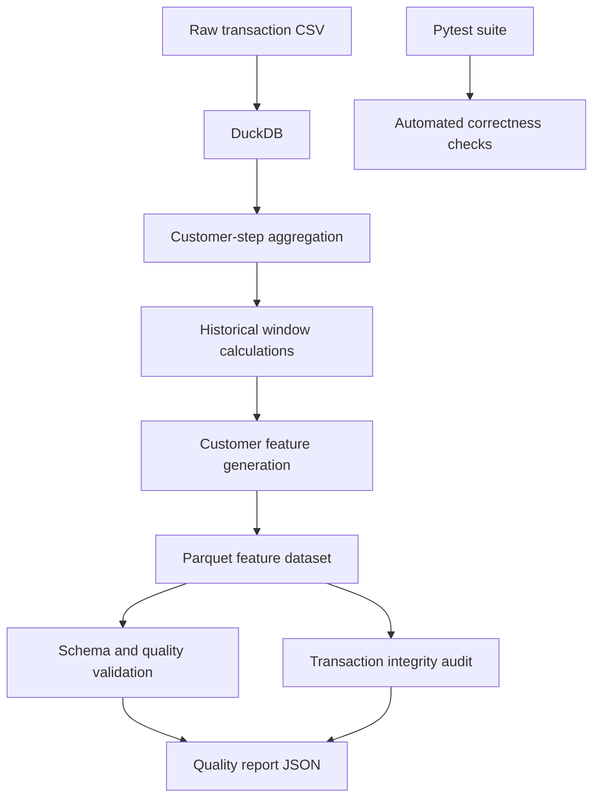

# Customer Risk Feature Store

[](https://github.com/Rauof-Qadir/customer-risk-feature-store/actions/workflows/tests.yml)

A batch feature-engineering pipeline that transforms transaction data into customer-level historical features for financial risk analytics and downstream machine-learning workflows.

## Overview

Financial risk models depend on reliable features. Incorrect historical calculations, duplicated transactions, and data leakage can undermine model performance.

This project uses **Python, DuckDB, SQL, and Parquet** to generate customer transaction-history features and validate the resulting dataset.

The pipeline has been locally tested on **6,362,620 transaction rows**, with automated checks for feature correctness, schema, data quality, and transaction preservation.

## Key Results

| Metric | Result |
|---|---:|
| Raw transaction rows | 6,362,620 |
| Generated feature rows | 6,362,620 |
| Feature-quality checks passed | 13/13 |
| Automated tests passed | 35/35 |
| Missing transactions in integrity audit | 0 |
| Extra or altered transactions in integrity audit | 0 |

*These results describe the current local test run. The GitHub Actions badge indicates the remote workflow's status.*

## Architecture



## Technology Stack

- **Python** — pipeline orchestration and validation
- **DuckDB** — analytical SQL and large-scale data processing
- **SQL** — historical aggregation and window functions
- **Parquet** — columnar feature storage
- **pytest** — automated testing
- **GitHub Actions** — continuous integration

## Features Generated

| Feature | Description |
|---|---|
| `customer_transaction_count` | Number of transactions before the customer's current step |
| `customer_prior_active_steps` | Number of earlier steps in which the customer was active |
| `customer_avg_transactions_per_active_step` | Historical transaction count divided by prior active steps |
| `customer_avg_amount` | Average transaction amount across prior transactions |
| `has_customer_history` | Indicator showing whether prior transaction history exists |
| `amount_vs_avg` | Current transaction amount divided by historical average amount, when defined |

### Preventing data leakage

Historical features use SQL window functions that exclude the current customer step and all transactions within that step from the history calculations.

Transactions belonging to the same customer and step therefore do not leak into one another's historical features.

This design is intended for historical feature generation. It does not, by itself, establish that a model training pipeline is free of every form of leakage.

## Data Quality and Integrity

The validator checks:

- Required columns and expected feature data types
- Raw and generated row-count consistency
- Missing customer identifiers, steps, and required features
- Nonnegative historical counts and consistent history flags
- Correct null behavior for historical averages
- Valid, nonnegative active-step averages
- Valid transaction-to-history ratios

A separate transaction-integrity audit compares the original transaction columns in the raw and feature datasets, preserving duplicate counts during comparison.

The latest local run reported zero missing transactions and zero extra or altered transaction records.

## Project Structure

```text
customer-risk-feature-store/
├── data/
│   ├── raw/
│   │   └── transactions.csv
│   ├── features/
│   │   └── customer_features.parquet
│   └── reports/
│       └── feature_quality_report.json
├── sql/
│   └── customer_features.sql
├── src/
│   └── feature_store/
│       ├── build_features.py
│       └── validate_feature_dataset.py
├── tests/
│   ├── test_customer_features.py
│   ├── test_customer_features_sql.py
│   ├── test_feature_dataset_quality.py
│   ├── test_synthetic_customer_features.py
│   └── test_transaction_integrity.py
├── run_pipeline.py
└── requirements.txt
```

## Getting Started

### 1. Clone the repository

```bash
git clone https://github.com/Rauof-Qadir/customer-risk-feature-store.git
cd customer-risk-feature-store
```

### 2. Create a virtual environment

Windows PowerShell:

```powershell
python -m venv .venv
.\.venv\Scripts\Activate.ps1
```

### 3. Install dependencies

```powershell
python -m pip install -r requirements.txt
```

### 4. Add the dataset

Place the transaction CSV at:

```text
data/raw/transactions.csv
```

Use the dataset version and license documented by its original provider. The pipeline expects the transaction columns used by the SQL feature-generation and validation code.

### 5. Run the pipeline

```powershell
python run_pipeline.py
```

The pipeline generates the Parquet feature dataset, runs data-quality validation, and executes the local test suite.

### 6. Run tests independently

```powershell
python -m pytest -v
```

## Current Scope and Limitations

- This is a **batch feature-engineering pipeline**, not a complete online feature store.
- The dataset uses a simulation-style `step` field rather than a real calendar timestamp.
- The source customer identifier is `nameOrig`; it should not automatically be interpreted as a verified real-world customer identity.
- Real-time feature serving, model training, production monitoring, and deployment are outside the current implementation.
- Successful local tests do not guarantee production readiness or fraud-model effectiveness.

## Future Improvements

- Add reproducible dataset-version and pipeline-run metadata.
- Add feature freshness and drift monitoring.
- Build an offline-versus-online feature consistency test if online serving is introduced.
- Benchmark runtime and memory consumption on documented hardware.
- Integrate generated quality reports into continuous integration where the dataset is available.

## Author

**Rauof Qadir**

Software Engineer | Data Science | Financial Risk Analytics

GitHub: https://github.com/Rauof-Qadir

---

*Built to demonstrate reliable feature engineering, historical SQL window calculations, data-quality validation, transaction integrity checks, and automated testing on a large transaction dataset.*
