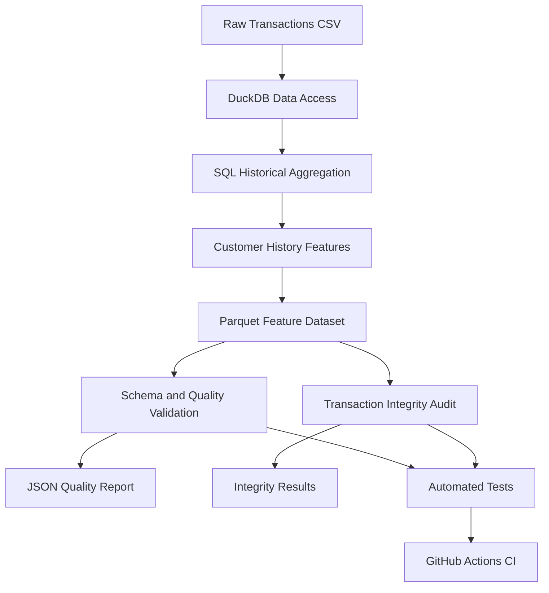

# Customer Risk Feature Store

**A SQL-driven batch feature engineering and data quality pipeline for financial risk analytics.**

[](https://github.com/Rauof-Qadir/customer-risk-feature-store/actions/workflows/tests.yml)


## Overview

Customer Risk Feature Store transforms raw financial transactions into customer-history features for downstream risk analytics and machine learning.

Built with Python, DuckDB SQL, Parquet, pytest, and GitHub Actions, the project focuses on historical feature engineering, transaction preservation, schema validation, and reproducible batch processing.

The pipeline has been locally validated against **6,362,620 transaction records** from a PaySim-style dataset.

### Latest local results

| Metric | Result |
|---|---:|
| Raw transactions processed | 6,362,620 |
| Feature output rows | 6,362,620 |
| Feature-quality checks | 13/13 passed |
| Automated tests | 35/35 passed |
| Missing transactions in integrity audit | 0 |
| Extra or altered transactions in integrity audit | 0 |

These results are from the latest reported local pipeline run. The GitHub Actions badge links to the repository's CI workflow for its current status.

> **Scope:** This is a batch feature engineering and validation project. It is not yet a deployed online feature store, real-time fraud detection service, or trained fraud classification model.

## Business problem

Risk analytics depends on trustworthy customer history. Incorrect historical aggregates, inconsistent schemas, or dropped transaction records can undermine downstream models and business decisions.

This project addresses four practical questions:

- Can we calculate customer-history features without using activity from the current simulation step?
- Can we preserve the original transaction records during feature generation?
- Can automated checks detect invalid feature values and schema changes?
- Can the pipeline be rerun and tested consistently?

## Architecture



### Pipeline workflow

1. **Ingest:** Read the raw transaction CSV using DuckDB.
2. **Aggregate:** Group transactions by originating customer and simulation step.
3. **Engineer:** Calculate historical features with SQL window functions.
4. **Export:** Write the feature dataset to Parquet.
5. **Validate:** Check required columns, data types, null rules, feature consistency, and numerical validity.
6. **Audit:** Compare raw and output transaction records, including duplicate multiplicities.
7. **Test:** Run automated unit, synthetic-data, and SQL integration tests.

## Engineered features

The pipeline produces **six features**: five customer-history features and one transaction-relative feature.

| Feature | Definition | Potential application |
|---|---|---|
| `customer_transaction_count` | Number of transactions before the current simulation step | Historical activity |
| `customer_prior_active_steps` | Number of distinct prior simulation steps with customer activity | Activity consistency |
| `customer_avg_transactions_per_active_step` | Historical transaction count divided by prior active steps | Transaction intensity |
| `customer_avg_amount` | Historical transaction amount sum divided by historical transaction count | Customer spending baseline |
| `has_customer_history` | `1` if prior transactions exist; otherwise `0` | Cold-start handling |
| `amount_vs_avg` | Current amount divided by historical average amount when the average is positive | Unusual amount analysis |

## Historical Calculations

For a customer at simulation step \(t\), historical features are calculated using transactions from **earlier simulation steps only**. Transactions from the current step are excluded from historical calculations to prevent data leakage.

### 1. Average Transactions per Active Step

\[
\text{Average Transactions per Active Step}
=
\frac{\text{Prior Transaction Count}}{\text{Prior Active Steps}}
\]

This measures the average number of transactions a customer makes during each previously active simulation step.

### 2. Amount vs. Historical Average

\[
\text{Amount vs. Historical Average}
=
\frac{\text{Current Transaction Amount}}{\text{Historical Average Amount}}
\]

This measures how large the current transaction is relative to the customer's historical average transaction amount.

**Handling unavailable historical values:** If a customer has no prior active steps, the average transactions per active step is `NULL`. If no valid historical average amount exists, or the historical average is zero, the amount-to-average ratio is `NULL` to avoid division by zero.

### Preventing same-step leakage

The SQL first aggregates activity by customer and simulation step. Window functions then calculate historical values using preceding rows only.

Consequently, multiple transactions belonging to the same customer at the current step receive the same historical feature values. They do not count one another as prior activity.

This is a historical feature calculation safeguard, not a guarantee that every possible downstream modeling pipeline is leakage-free.

## Data quality and integrity

### Feature-quality validation

The automated validator checks 13 conditions:

- Required columns are present.
- Feature column types match the expected schema.
- Raw and feature row counts match.
- Customer identifiers and simulation steps are present.
- Required historical features are populated.
- Historical counts are non-negative.
- History flags contain valid values and agree with historical counts.
- Average null rules are respected.
- Historical amount averages are present when required.
- Average transaction counts per active step are non-negative.
- Non-null amount ratios are finite and non-negative.

### Transaction integrity audit

The integrity audit compares the original transaction columns in the raw and feature datasets using multiset comparison. This checks both record values and duplicate counts, rather than relying only on row counts or assuming that customer and simulation step uniquely identify a transaction.

Latest local result:

| Integrity metric | Result |
|---|---:|
| Missing transactions | 0 |
| Extra or altered transactions | 0 |
| Integrity status | PASS |

The audit covers the original transaction fields; it does not establish the correctness of every engineered feature or prove that the source dataset is accurate.

### Automated testing

The local suite contains 35 tests covering:

- Feature output existence and expected row count.
- Required feature availability and numerical consistency.
- Historical calculations and current-step leakage prevention.
- First-transaction behavior.
- Synthetic customer histories and non-trivial averages.
- Quality-check failure conditions.
- Feature schema type validation.
- Transaction integrity with duplicate and missing-record scenarios.

**Latest reported local result: 35 passed.**

## Dataset

The input is a PaySim-style synthetic financial transaction dataset.

| Attribute | Value |
|---|---:|
| Transaction records | 6,362,620 |
| Raw columns | 11 |
| Fraud-labelled transactions | 8,213 |
| Transaction types | 5 |
| Raw missing values | 0 |
| Exact duplicate groups reported in raw data | 0 |

### Input schema

| Column | Description |
|---|---|
| `step` | Simulation-time step |
| `type` | Transaction type |
| `amount` | Transaction amount |
| `nameOrig` | Originating account identifier |
| `oldbalanceOrg` | Origin balance before transaction |
| `newbalanceOrig` | Origin balance after transaction |
| `nameDest` | Destination account identifier |
| `oldbalanceDest` | Destination balance before transaction |
| `newbalanceDest` | Destination balance after transaction |
| `isFraud` | Fraud label |
| `isFlaggedFraud` | Dataset-provided fraud flag |

**Data considerations**

- `step` represents simulation time, not a verified calendar timestamp.
- Account identifiers are dataset identifiers, not verified real-world identities.
- The raw dataset is not included in this repository. Obtain it from its original source and verify the applicable licence and usage terms.
- Place the CSV at `data/raw/transactions.csv`.

## Tech stack

| Technology | Purpose |
|---|---|
| Python | Pipeline orchestration and validation |
| DuckDB | Analytical SQL execution |
| SQL window functions | Historical feature engineering |
| Parquet | Columnar feature storage |
| pytest | Automated testing |
| GitHub Actions | Continuous integration |
| JSON | Machine-readable quality reports |
| Git | Version control |

## Getting started

### Prerequisites

- Python 3.11 or newer
- Git
- The raw transaction CSV dataset

### 1. Clone the repository

```bash
git clone https://github.com/Rauof-Qadir/customer-risk-feature-store.git
cd customer-risk-feature-store
```

### 2. Create a virtual environment

Windows PowerShell:

```powershell
python -m venv .venv
.venv\Scripts\Activate.ps1
```

macOS/Linux:

```bash
python -m venv .venv
source .venv/bin/activate
```

### 3. Install dependencies

```bash
python -m pip install --upgrade pip
python -m pip install duckdb pandas numpy pyarrow scikit-learn pytest
```

### 4. Add the dataset

Place the input CSV at:

```text
data/raw/transactions.csv
```

Ensure its columns match the documented input schema.

### 5. Run the complete pipeline

```bash
python run_pipeline.py
```

This command builds the feature dataset, runs quality validation and the transaction integrity audit, and executes the local test suite.

### 6. Run individual stages

Build features:

```bash
python -m src.feature_store.build_features
```

Validate the feature dataset:

```bash
python -m src.feature_store.validate_feature_dataset
```

Run tests:

```bash
python -m pytest -v
```

### Generated outputs

| Output | Location |
|---|---|
| Feature dataset | `data/features/customer_features.parquet` |
| Quality report | `data/reports/feature_quality_report.json` |

The full pipeline requires the raw dataset and can take longer than running isolated synthetic tests.

## Repository structure

```text
customer-risk-feature-store/
├── .github/
│   └── workflows/
│       └── tests.yml
├── data/
│   ├── raw/
│   ├── features/
│   └── reports/
├── sql/
│   └── customer_features.sql
├── src/
│   └── feature_store/
│       ├── build_features.py
│       └── validate_feature_dataset.py
├── tests/
│   ├── test_customer_features.py
│   ├── test_customer_features_sql.py
│   ├── test_feature_dataset_quality.py
│   ├── test_synthetic_customer_features.py
│   └── test_transaction_integrity.py
├── run_pipeline.py
└── README.md
```

## Limitations and future improvements

### Modeling and leakage

The generated dataset retains original transaction columns, including `isFraud` and `isFlaggedFraud`. Downstream model training must exclude target labels and any fields unavailable at prediction time.

Historical feature calculations alone do not guarantee a leakage-free modeling dataset.

### Simulation time

The current implementation orders activity by simulation step. It does not establish exact real-world timestamps or support claims about calendar days or rolling 7-day and 30-day windows.

### Batch feature store scope

The current implementation writes a batch Parquet dataset. The following capabilities remain future work:

- Feature-definition and schema versioning.
- Point-in-time joins and broader leakage tests.
- Feature distribution and drift monitoring.
- Reproducible, pinned dependency management.
- Model evaluation using a time-aware fraud-risk split.
- Online feature serving and production deployment.

## Author

**Rauof Qadir**
Software Engineer | Aspiring Data Scientist

- [GitHub profile](https://github.com/Rauof-Qadir)
- [Project repository](https://github.com/Rauof-Qadir/customer-risk-feature-store)

---

*Built to explore reliable feature engineering, historical data correctness, and automated data quality for financial risk analytics.*