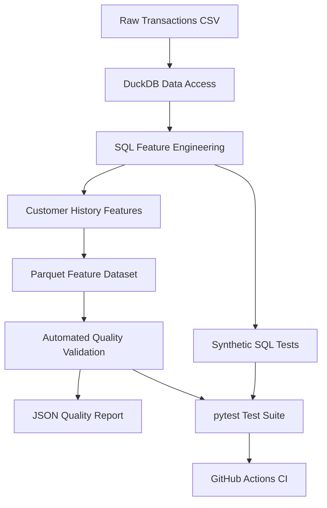

# Customer Risk Feature Store

<p align="center">
  <strong>A SQL-driven feature engineering and data quality pipeline for transaction risk analytics.</strong>
</p>

<p align="center">
  <a href="https://github.com/Rauof-Qadir/customer-risk-feature-store/actions/workflows/tests.yml"></a>
  
  
  
  
  
  
</p>

<p align="center">
  <a href="#overview">Overview</a> •
  <a href="#architecture">Architecture</a> •
  <a href="#engineered-features">Features</a> •
  <a href="#data-quality--testing">Quality & Testing</a> •
  <a href="#getting-started">Getting Started</a>
</p>

---

## Overview

The **Customer Risk Feature Store** is a data engineering project that transforms raw financial transaction data into customer-level historical features for risk analytics and future machine learning applications.

Built with Python, DuckDB SQL, Parquet, pytest, and GitHub Actions, the pipeline focuses on historical feature engineering, data integrity, reproducible processing, and automated validation.

The project uses a PaySim-style financial transaction dataset containing approximately **6.36 million transactions**.

### Key Highlights

- **6,362,620** transaction records processed.
- **5** engineered customer-history features.
- **12/12** feature dataset quality checks passed in the latest local validation run.
- **18/18** local automated tests passed in the latest full test run.
- Production SQL tested against synthetic datasets, including edge cases.
- GitHub Actions CI successfully executed the configured test workflow.
- Parquet output for efficient analytical data storage.

> **Project scope:** This repository builds and validates risk-related features. It is not yet a deployed real-time feature store or a production fraud-detection model.

## Architecture



### Pipeline Workflow

1. **Ingest:** Read the raw transaction CSV using DuckDB.
2. **Aggregate:** Calculate customer transaction counts and amounts per simulation step.
3. **Engineer:** Use SQL window functions to compute historical customer features without including transactions from the current step.
4. **Export:** Save the resulting feature dataset as Parquet.
5. **Validate:** Check schema, row counts, historical values, null rules, and feature consistency.
6. **Test:** Execute automated unit, synthetic-data, and SQL integration tests.
7. **Automate:** Run the configured CI tests on pushes and pull requests.

## Tech Stack

| Technology | Purpose |
|---|---|
| Python | Pipeline orchestration and validation |
| DuckDB | Analytical SQL execution over transaction data |
| SQL window functions | Historical customer feature engineering |
| Parquet | Columnar feature dataset storage |
| pytest | Automated testing |
| GitHub Actions | Continuous integration |
| JSON | Machine-readable quality reports |
| Git | Version control |

## Dataset

The input dataset contains transaction-level financial activity.

| Attribute | Value |
|---|---:|
| Rows | 6,362,620 |
| Raw columns | 11 |
| Fraud-labelled transactions | 8,213 |
| Transaction types | 5 |
| Missing values in raw data | 0 |
| Exact duplicate groups in raw data | 0 |

### Input Schema

| Column | Description |
|---|---|
| `step` | Simulation-time step |
| `type` | Transaction type |
| `amount` | Transaction amount |
| `nameOrig` | Originating account identifier |
| `oldbalanceOrg` | Origin account balance before transaction |
| `newbalanceOrig` | Origin account balance after transaction |
| `nameDest` | Destination account identifier |
| `oldbalanceDest` | Destination account balance before transaction |
| `newbalanceDest` | Destination account balance after transaction |
| `isFraud` | Fraud label |
| `isFlaggedFraud` | Dataset-provided fraud flag |

**Data note:** `step` represents simulation time, not a verified calendar timestamp. The project does not assume real-world dates, weekdays, or rolling 7-day/30-day windows.

The raw dataset is not included in this repository. Obtain the dataset from its original source, verify its permitted usage, and place the CSV at `data/raw/transactions.csv`.

## Engineered Features

The pipeline generates five historical customer features and one transaction-relative ratio.

| Feature | Definition | Potential application |
|---|---|---|
| `customer_transaction_count` | Number of the customer's transactions before the current simulation step | Historical activity measurement |
| `customer_prior_active_steps` | Number of distinct prior simulation steps in which the customer transacted | Activity consistency |
| `customer_avg_transactions_per_active_step` | Historical transaction count divided by prior active steps | Transaction intensity |
| `customer_avg_amount` | Historical transaction amount sum divided by historical transaction count | Customer spending baseline |
| `has_customer_history` | `1` if prior transactions exist; otherwise `0` | Cold-start handling |
| `amount_vs_avg` | Current transaction amount divided by historical average transaction amount, when that average is positive | Unusual transaction amount analysis |

### Historical Feature Logic

For a customer at simulation step \(t\), only transactions from earlier steps are used.

\[
\text{Avg Transactions per Active Step}
=
\frac{\text{Historical Transaction Count}}
{\text{Prior Active Steps}}
\]

\[
\text{Amount vs Average}
=
\frac{\text{Current Transaction Amount}}
{\text{Historical Average Amount}}
\]

If no valid historical denominator exists, the corresponding average or ratio is `NULL`.

### Preventing Same-Step Leakage

The SQL first aggregates transactions by customer and simulation step. Window functions then calculate history using preceding rows only.

This ensures that multiple transactions belonging to the same customer at the current step receive the same historical feature values, without counting one another as prior activity.

## Data Quality & Testing

Data quality is treated as a core part of the feature engineering pipeline.

### Feature Dataset Quality Checks

The local validation report includes 12 checks:

- Required columns exist.
- Feature row count matches the raw input row count.
- Customer identifiers are present.
- Simulation steps are present.
- Required historical features are populated.
- Historical counts are non-negative.
- History flags contain valid values.
- History flags agree with historical counts.
- Average null rules are respected.
- Historical amount averages are present when required.
- Average transaction counts per active step are non-negative.
- Non-null amount ratios are finite and non-negative.

### Automated Tests

The test suite covers:

- Dataset existence and expected row count.
- Required feature availability.
- Historical feature consistency.
- Non-negative historical counts.
- Historical feature timing.
- Active-step calculations.
- Synthetic customer histories with non-trivial averages.
- First-transaction behavior.
- Same-step leakage prevention.
- Quality-rule behavior.

### Latest Verified Results

| Validation | Result |
|---|---:|
| Local feature quality checks | 12/12 passed |
| Full local pytest suite | 18/18 passed |
| Production SQL integration tests | 3 passed |
| GitHub Actions workflow | Success |
| Feature dataset rows | 6,362,620 |

These results describe the latest reported local runs and the successful GitHub Actions run. The full local suite and the CI-selected tests are not necessarily the same test set.

## Getting Started

### Prerequisites

- Python 3.11+
- Git
- A compatible Windows, macOS, or Linux environment
- The raw transaction CSV dataset

### 1. Clone the Repository

```bash
git clone https://github.com/Rauof-Qadir/customer-risk-feature-store.git
cd customer-risk-feature-store
```

### 2. Create a Virtual Environment

Windows PowerShell:

```powershell
python -m venv .venv
.\.venv\Scripts\Activate.ps1
```

macOS/Linux:

```bash
python -m venv .venv
source .venv/bin/activate
```

### 3. Install Dependencies

```bash
python -m pip install --upgrade pip
python -m pip install duckdb pandas numpy pyarrow scikit-learn pytest
```

### 4. Add the Dataset

Place the raw CSV here:

```text
data/raw/transactions.csv
```

Ensure the input columns match the schema described above.

### 5. Build the Feature Dataset

Run:

```bash
python -m src.feature_store.build_features
```

The generated dataset is saved to:

```text
data/features/customer_features.parquet
```

### 6. Validate the Feature Dataset

```bash
python -m src.feature_store.validate_feature_dataset
```

The quality report is saved to:

```text
data/reports/feature_quality_report.json
```

### 7. Run Automated Tests

Run the complete local test suite:

```bash
python -m pytest -v
```

Some full-dataset tests depend on the generated Parquet file and the original dataset being available locally.

### 8. Run the Full Local Pipeline

```bash
python run_pipeline.py
```

This runs feature generation, feature quality validation, and the full local pytest suite in sequence. Feature generation processes the large input dataset, so this command can take longer than running the small synthetic tests.

## Repository Structure

```text
customer-risk-feature-store/
├── .github/
│   └── workflows/
│       └── tests.yml
├── data/
│   ├── raw/
│   ├── processed/
│   ├── features/
│   └── reports/
├── sql/
│   └── customer_features.sql
├── src/
│   └── feature_store/
│       ├── analyze_history_patterns.py
│       ├── build_features.py
│       ├── inspect_data.py
│       ├── validate_data.py
│       ├── validate_feature_dataset.py
│       ├── verify_active_steps.py
│       ├── verify_features.py
│       ├── verify_historical_features.py
│       ├── verify_multi_step_history.py
│       ├── check_average.py
│       └── check_amount_vs_avg.py
├── tests/
│   ├── test_customer_features.py
│   ├── test_customer_features_sql.py
│   ├── test_feature_dataset_quality.py
│   └── test_synthetic_customer_features.py
├── run_pipeline.py
├── .gitignore
└── README.md
```

## Important Considerations

### 1. Historical Features and Model Leakage

The historical SQL features exclude transactions from the current simulation step. However, the output also retains the original transaction columns, including `isFraud` and `isFlaggedFraud`.

When preparing model training data, explicitly exclude target labels and any unavailable-at-prediction-time fields. A feature being historically calculated does not automatically guarantee that the entire model dataset is leakage-free.

### 2. Simulation Time

The current dataset supports ordering by simulation step. It does not establish exact real-world timestamps or justify calendar-based or rolling-window features.

### 3. Dataset-Specific Behavior

The observed raw data contains 9,266 customer-step records with prior history. In the history-pattern analysis, the maximum historical transaction count and maximum prior active steps were both 2. No non-trivial average-per-active-step cases appeared in that analysis.

Synthetic integration tests therefore exercise additional scenarios that the observed dataset does not adequately cover.

### 4. Feature Store Scope

This is currently a batch feature engineering pipeline that writes a Parquet dataset. Online feature serving, point-in-time joins, feature versioning, freshness monitoring, and production deployment are future improvements—not existing capabilities.

## Roadmap

- [x] Raw data inspection and validation
- [x] SQL-based historical feature engineering
- [x] Parquet feature dataset generation
- [x] Automated feature quality report
- [x] Synthetic and SQL integration tests
- [x] GitHub Actions CI workflow
- [ ] Refactor validation rules for shared production/test reuse
- [ ] Add reproducible dependency lock or pinned requirements
- [ ] Add documented data provenance and dataset licensing
- [ ] Add schema and feature-definition versioning
- [ ] Add point-in-time correctness and stronger leakage tests
- [ ] Add feature distribution and drift monitoring
- [ ] Evaluate features in a time-aware fraud-risk modelling pipeline
- [ ] Explore online feature serving and deployment

## Author

**Rauof Qadir**  
Software Engineer | Aspiring Data Scientist

GitHub: [@Rauof-Qadir](https://github.com/Rauof-Qadir)

Project repository: [Customer Risk Feature Store](https://github.com/Rauof-Qadir/customer-risk-feature-store)

---

<p align="center">
  <sub>Built to explore reliable feature engineering, historical data correctness, and automated data quality for financial risk analytics.</sub>
</p>
